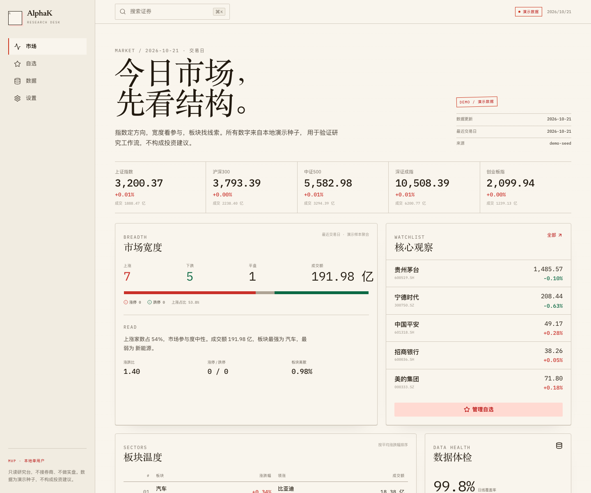
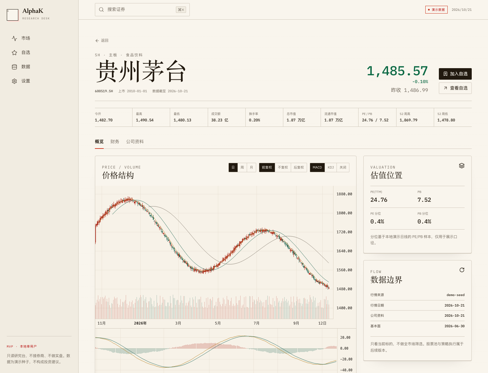

# AlphaK · A 股研究工作台（MVP）

本地优先、纯 Web 的 A 股研究工作台。市场页仅展示真实行情，后台更新已导入和自选证券及指数；接入腾讯、东方财富和新浪公开源，不接实盘、不做全市场扫描。

市场页的涨跌分布仅统计本地真实样本，不代表全市场。后台行情快照每 60 秒更新（最多 8 个并发），历史日线每 15 分钟补齐。个股支持 1/5/15/30/60 分钟 K 线及日、周、月线；分钟线、估值每 60 秒更新，公司资料及财报缓存 24 小时。无真实行情时显示待同步，未接入的真实板块数据留空。

旧任务／回填入口中的 mock adapter 默认禁用，防止后台任务把演示数据重新写入；尚未接入真实源的数据集会明确报错。离线演示环境可显式设置 `ALPHAK_ALLOW_DEMO_SYNC=1`，日常研究不应开启。

## 技术栈

| 层 | 实现 |
| --- | --- |
| 后端 | Rust · Axum · rusqlite（SQLite） |
| 前端 | Vite · React 19 · TypeScript · 手写 Hallmark design tokens |
| 图表 | TradingView Lightweight Charts |
| 数据 | SQLite 本地文件；默认演示种子；可选腾讯/东财公开源小样本同步 |

> 架构口径：MVP 固定为 Rust/Axum + SQLite + Vite/React，**直接本机运行，不依赖 Docker**；数据库只用 SQLite，不引入 PostgreSQL/TimescaleDB/Redis。
>
> 当前进度与剩余缺口见 [Implementation Status](docs/implementation-status.md)；文档 Review 结论见 [Review Supplement Checklist](docs/review-supplement-checklist.md)。

## 构建、启动与停止

构建环境需要 Rust/Cargo、Node.js 20.19+（或 22.12+）、npm 和 Make。脚本适用于 macOS/Linux。以下命令从项目根目录执行。

### 1. 打包完整应用

```bash
make build
```

构建后端 release、安装锁定的前端依赖并完成 TypeScript 检查和前端构建，然后把完整应用打包到 `dist/alphak/`：

```text
dist/alphak/
├── bin/alphak-api       # 后端可执行文件，同时提供前端静态资源
├── web/                # 构建好的前端 HTML、CSS、JavaScript
├── scripts/start.sh    # 后台启动
├── scripts/stop.sh     # 停止
├── scripts/backup.sh   # SQLite 备份工具
└── .env.example        # 配置示例
```

运行打包应用不需要 Node.js、npm 或 Rust，也不需要启动 Vite；需要 Bash、`sqlite3`、`shasum`（用于启动前备份已有数据库）。产物适用于构建时的操作系统和 CPU 架构。更新前先停止应用，再重新执行 `make build`。

### 2. 配置与启动

首次使用可以复制配置示例；已有 `.env` 时直接编辑，不要覆盖：

```bash
cp .env.example .env
./scripts/start.sh
```

浏览器打开 **<http://127.0.0.1:8080>**，页面和 `/api` 使用同一个服务。启动脚本后台运行打包好的程序，等待监听成功后返回；重复启动会提示已运行。

默认监听 `127.0.0.1:8080`，只允许回环地址。后端加载根目录的 `.env`，已导出的环境变量优先；`ALPHAK_BIND` 可修改监听地址，`ALPHAK_DB` 可指定数据库位置。默认数据库为根目录的 `alphak.db`，首次启动自动初始化。已有数据库会在启动迁移前备份至根目录的 `backups/pre-migrate-*.db`，备份失败会拒绝启动。

日志位于 `dist/alphak/logs/alphak.log`，每次启动重新写入；PID 文件位于 `dist/alphak/run/alphak.pid`。

```bash
# 查看日志
tail -f dist/alphak/logs/alphak.log

# 检查服务
curl http://127.0.0.1:8080/api/v1/health
```

### 3. 停止与重启

```bash
./scripts/stop.sh

# 重启
./scripts/start.sh
```

停止脚本按 PID 停止本应用，不按端口批量杀进程；数据库、自选和设置保留。停止后可以安全重新构建。

需要彻底重置构建环境时执行 `make clean`：会先停止正在运行的 AlphaK，然后删除 Cargo `target/`、前端依赖 `node_modules/`、前端 `dist/`、Vite 与 Playwright 产物，以及 `dist/alphak/` 下的程序、页面、脚本和日志；`alphak.db`、`dist/alphak/backups/`、根目录 `backups/`、`data/` 和 `.env` 会保留。清理后重新执行 `make build`，再运行 `./scripts/start.sh`。

### 4. 独立目录运行

可以将整个 `dist/alphak/` 复制到同操作系统、同 CPU 架构的机器或其他目录，在复制后的目录运行：

```bash
cd /path/to/alphak
cp .env.example .env  # 仅首次配置
./scripts/start.sh
./scripts/stop.sh
```

独立目录的 `.env`、`alphak.db`、`logs/`、`run/` 都位于该应用目录。复制构建目录不会自动带上项目根目录已有的数据库或 `.env`，迁移已有数据请在停止后复制或使用备份恢复流程。

### 5. 开发与验证

```bash
# 前端开发服务（另一个终端，API 默认 8080）
make web

# 单独构建前后端；完整打包仍使用 make build
make build-api
make build-web

# 后端测试
cargo test --manifest-path apps/api/Cargo.toml
```

开发页面为 <http://127.0.0.1:5173>，支持热更新；前端代理默认指向 `127.0.0.1:8080`。按 Ctrl+C 停止前端开发服务。运行 `make` 可查看帮助。

## 页面

- `/` 市场概览：指数、市场宽度、板块温度、自选快照、数据体检
- `/stock/600519.SH` 个股：K 线、MA/MACD/KDJ、财务、公司资料
- `/index/000300.SH` 指数详情与成分
- `/sector/1` 板块详情与成员
- `/watchlist` 自选分组、添加/删除、CSV 导入导出、轮询
- `/data` 数据体检、任务状态、来源健康/新鲜度、手动触发
- `/settings` 本地单用户设置

## API

`GET /api/v1/health` · `GET /api/v1/market/overview` · `GET /api/v1/instruments/search?q=` · `GET /api/v1/instruments/{symbol}` · `GET /api/v1/instruments/{symbol}/bars` · `GET /api/v1/instruments/{symbol}/fundamentals` · `GET /api/v1/instruments/{symbol}/profile` · `GET /api/v1/indices/{code}` · `GET /api/v1/sectors` · `GET/POST /api/v1/watchlists` · `GET/PUT /api/v1/settings` · `GET /api/v1/admin/data-jobs` · `GET /api/v1/admin/quality`

响应统一为 `{ code, message, data, request_id }`。

## 备份与恢复

```bash
# 备份：生成 backups/alphak-<timestamp>.db 与 .sha256
scripts/backup.sh

# 恢复：校验 checksum → 备份当前库 → integrity_check → 恢复
scripts/restore.sh backups/alphak-<timestamp>.db
```

恢复默认写入 `ALPHAK_DB` 指向的数据库；脚本会先备份当前状态，损坏的备份会被拒绝。

## 测试与 CI

```bash
cargo test --manifest-path apps/api/Cargo.toml
cd apps/web && npm run build && npx playwright test
```

CI 配置见 `.github/workflows/ci.yml`。E2E 需要本地 API 与 Vite 已启动。

## 文档

- [部署与运维](docs/deployment.md)
- [数据源范围与 ToS](docs/data-sources.md)
- [指标口径](docs/indicators.md)
- [性能快照](docs/performance.md)
- [OpenAPI](docs/api/openapi.json)

## 数据与边界

- 默认包含演示种子；公开源同步只用于个人研究小样本，行情来源、批次与新鲜度记录在 SQLite。
- 行情与估值/财务可能来自不同来源，页面按字段显示来源；未同步字段仍可能是演示样本。
- 全部来源失败时保留最后成功数据并标记过期，不自动回退 mock。
- 不提供全市场条件筛选、策略池、回测、虚拟盘、Agent 或回放入口；这些属于 V1。
- 不接券商、不产生真实委托。
- 公开接口不是官方授权；上游 ToS、限频与再分发限制仍需核对。
- 删除 `alphak.db` 后重启即可重新生成演示数据。

## 截图





## 设计

- 设计系统：`design.md`（Market Terminal），`tokens.css` 与 `apps/web/src/tokens.css` 保持一致。
- Hallmark 记录：`.hallmark/log.json`。
- 设计语气：高密度行情终端，冷色背景与蓝色控件；数字等宽、标题无衬线，无大幅宣传文案。

### 搜索与外观

市场后台每 60 秒更新已导入及自选证券和 5 个指数的行情快照，不依赖浏览器是否打开；历史日线每 15 分钟分批补齐。个股页每 60 秒获取行情、分钟线及估值，市场与指数详情页每 10 秒读取本地结果，自选页遵循设置中的轮询间隔。公开行情可能延迟，不提供逐笔实时交易数据。

腾讯/东方财富/新浪主备切换，每个行情来源最多尝试 2 次；失败范围进入后台队列，每分钟最多重试一轮，同一范围最多自动重试 5 次。分钟线优先东方财富、备用新浪；估值优先东方财富、备用腾讯；公司资料和财报使用东方财富两个服务地址。补充数据连续失败最多 5 轮后停止，可在个股页点击「重新补取」。失败保留最后成功数据，未补齐缺口不会误清除重试任务。指数同时显示点位、涨跌点数和涨跌幅。

分钟 K 线使用真实 OHLC，时间统一为中国时区并按 UTC 时间戳传输；分钟线不复权。估值补充总市值、流通市值、PE(TTM)、PB、换手及股本；财务按相同报告期合并利润表、资产负债表、现金流和主要财务指标，采用本年累计口径。公司资料补充行业、上市日期、业务、控制人、地区和网站。未取得的字段继续留空，不用 0 或演示值填充。历史估值分位需要真实长期样本，当前个股页改为展示真实股本。

自选输入框支持名称、代码及拼音检索，点击候选结果即可加入当前分组。删除分组需要确认，会移除该分组的自选记录并保留行情数据；至少保留一个分组。

证券搜索优先查询本地缓存；本地无匹配时按关键词查询腾讯证券接口，支持 A 股名称、代码和拼音首字母，例如 `沪电股份`、`002463`、`hdgf`。首次打开新证券会通过现有多源行情链路补取最近一年的日线，首次加载需要联网；上游不可用时会显示错误，可重试。未取得的行业、上市日期、财务等字段不会用演示值补齐。

设置中的主题、涨跌颜色和密度更改后立即生效并自动保存，无需保存或取消按钮；保存失败会显示提示。跟随系统会响应系统深浅色变化，图表同步切换。侧栏 Logo 和浏览器图标均使用项目根目录的透明矢量 `logo.svg`，原始 `logo.png` 保留为参考。替换 SVG 后重新构建前端即可更新。

市场「板块温度」读取东方财富行业汇总，失败切换新浪行业汇总，每分钟更新，显示来源、更新时间及过期状态。热度以涨跌幅排序，最高和最低模式各展示8项，正常模式展示两端各4项。页面限制在视口内，较小屏幕的列表在面板内部滚动。只请求板块汇总，不扫描板块全部成分股；汇总记录没有成分详情时不提供虚假的详情入口。「人气股」读取东方财富公开人气榜前12名，每分钟更新，按真实人气名次排序，不使用自选分组或涨幅代替人气。
